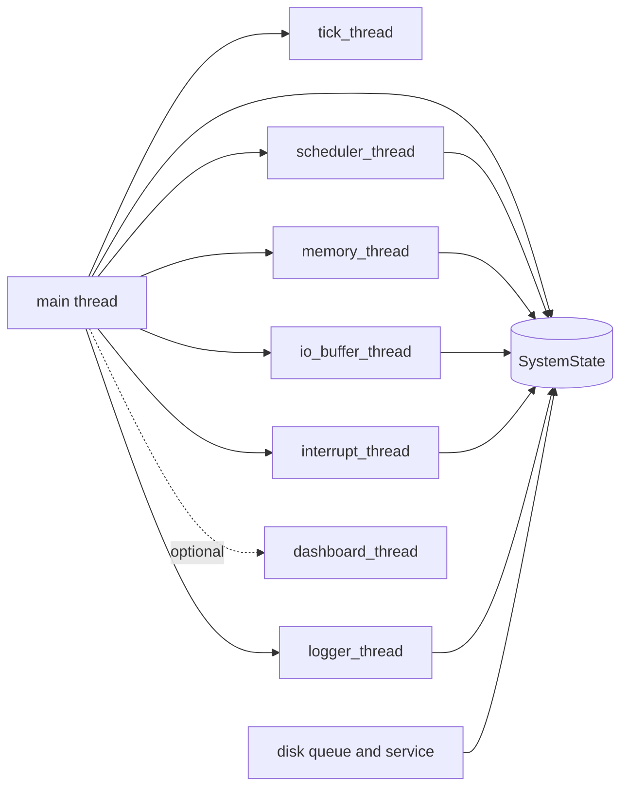
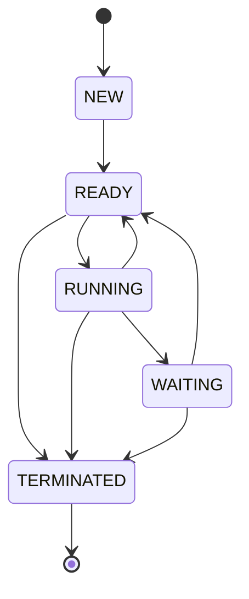
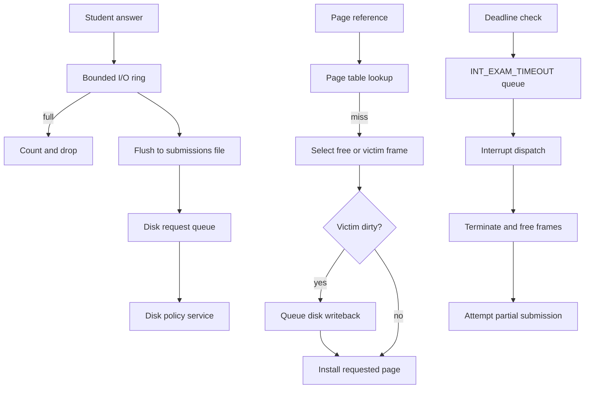

# Architecture

## Overview

Exam OS is one C process containing concurrent subsystem threads. The shared `SystemState` and `IOBuffer` objects are declared in `exam_os/src/main.c` and described by `exam_os/include/shared.h`. They model an exam service; they are not kernel objects or operating-system resources.

`main` loads built-in defaults, reads `config.conf`, applies command-line options, validates configuration, initializes modules, starts threads, waits for an end condition, joins threads, and writes reports. The dashboard is optional and is omitted in headless mode. See `exam_os/src/main.c::main` and `exam_os/src/config.c::config_validate`.

## Threads

- `tick_thread` increments `g_state.current_tick`, broadcasts `g_state.tick_cv`, and sleeps for the configured tick duration. It is implemented in `exam_os/src/main.c::tick_thread`.
- `scheduler_thread` admits arrivals, wakes waiting sessions, selects ready work, accounts CPU ticks, and writes an optional trace. It is implemented in `exam_os/src/scheduler.c::scheduler_thread`.
- `memory_thread` generates references for the process currently marked running and passes them to the pager. It is implemented in `exam_os/src/memory.c::memory_thread`.
- `io_buffer_thread` generates legacy submissions, flushes the bounded buffer, and services disk batches. It is implemented in `exam_os/src/io_buffer.c::io_buffer_thread`.
- `interrupt_thread` checks deadlines and buffer pressure, then drains the interrupt queue. It is implemented in `exam_os/src/interrupt.c::interrupt_thread`.
- `logger_thread` removes queued log entries and writes them to the log file. It is implemented in `exam_os/src/logger.c::logger_thread`.
- `dashboard_thread` snapshots shared state and renders ncurses panels until shutdown or a quit key. It is implemented in `exam_os/src/dashboard.c::dashboard_thread`.

The six subsystem loops other than the dashboard are started in both interactive and headless modes. The dashboard loop is started only when headless mode is off; see `exam_os/src/main.c::main`.

## Data ownership

- The process table and counters live in `g_state`, defined in `exam_os/src/main.c` and protected by `g_state.lock` when shared fields are accessed.
- The ready queue is a private array in `exam_os/src/scheduler.c`; `rq_lock` protects its contents.
- The frame pool and per-slot page tables are private to `exam_os/src/memory.c`; `mem_lock` protects them.
- The bounded submission ring is referenced by `g_io_buffer`, allocated by `io_buffer_init`, and protected by its mutex and empty/filled POSIX semaphores.
- Pending disk cylinders and request kinds are private to `exam_os/src/disk.c`; `disk_lock` protects the pending queue and `svc_lock` serializes service and head state.
- The pending interrupt ring and vector table are private to `exam_os/src/interrupt.c`, protected separately by `int_q_lock` and `ivt_lock`.
- The asynchronous log ring is private to `exam_os/src/logger.c`; `q_lock` and `q_ready` protect and signal it.
- Each worker thread has a thread-local pseudo-random stream initialized by `rng_init_thread` in `exam_os/src/rng.c`.

These structures exchange summaries through `g_state`; queue and pool contents are not themselves stored in the dashboard snapshot.

## Lock order

The observed nested locking order is:

- `rq_lock` then `g_state.lock` when changing or selecting ready-queue entries in `exam_os/src/scheduler.c::dispatch_one` and `exam_os/src/scheduler.c::enqueue_slots`.
- `mem_lock` then `g_state.lock` in pager accounting and auditing, including `exam_os/src/memory.c::memory_access_rw` and `exam_os/src/memory.c::memory_audit`.
- During dirty eviction, `mem_lock` remains held while `load_page` calls `disk_enqueue`; `disk_enqueue` nests `disk_lock` then `g_state.lock`. This gives `mem_lock -> disk_lock -> g_state.lock`.
- `disk_service` takes `svc_lock` then `disk_lock` to detach a batch. It releases `disk_lock` before updating shared counters under `g_state.lock`, so the nested paths are `svc_lock -> disk_lock` and later `svc_lock -> g_state.lock`.
- `g_io_buffer.lock` may nest `g_state.lock` while buffer and submission counters change in `exam_os/src/io_buffer.c::io_buffer_submit` and `exam_os/src/io_buffer.c::flush_buffer`.
- `q_lock` may nest `g_state.lock` only when the log queue is full; `int_q_lock` may nest it only when the interrupt queue is full.

`process_terminate` releases `g_state.lock` before calling `memory_free_process`, so that path does not nest the state lock above the memory lock. The timeout handler submits a partial answer only after termination and memory release. `load_page` performs `usleep(500)` while `mem_lock` is held. Disk servicing releases the queue lock before scheduling and trace-file writes; service serialization remains held during that work. These are code observations, not a general proof that arbitrary new lock combinations are safe.

## Process state machine

`process_set_state` in `exam_os/src/process.c::process_set_state` accepts only the transitions below. New sessions enter ready through `scheduler_add_process`; completion and timeout paths terminate eligible non-new sessions.

`WAITING` is used for interactive CPU bursts and for a successful interactive submission until the next tick. A waiting session returns to `READY` when its wake condition is reached. See `exam_os/src/scheduler.c::wake_sleepers` and `exam_os/src/io_buffer.c::io_buffer_submit`.

## Request flows

A student answer enters the ring through `io_buffer_submit`. A full buffer causes the non-blocking producer to count and drop the item. The flusher removes queued records, writes `output/submissions.txt`, and enqueues their cylinder requests; `disk_service` batches those requests using the selected disk algorithm.

A page reference reaches `memory_access_rw` from the memory thread. A valid entry updates its access metadata; a miss allocates a free frame or selects FIFO, LRU, or CLOCK eviction. A dirty victim increments the writeback count and enqueues a disk request. The offline `pagesim` supports OPT, but the live pager does not.

A deadline check marks an expired session pending under `g_state.lock`, then raises `INT_EXAM_TIMEOUT` after releasing that lock. The interrupt loop dequeues and dispatches it. `handle_exam_timeout` terminates the session, releases its frames, and attempts to submit a partial answer.

## Time model

`tick_thread` advances the simulation’s integer tick and broadcasts `tick_cv`; `wait_for_tick` in `exam_os/src/scheduler.c` waits on that condition variable with a timed-wait fallback and computes how many ticks elapsed. Work and most durations are accounted in ticks. `sim_sleep_ticks` converts ticks to `g_config.tick_ms` and calls `nanosleep`.

`TICK_MS` is the configuration-file key and `--tick-ms` is the command-line option; the built-in default is 100 milliseconds and `config.conf` also sets 100. `clock_now_ms` uses `CLOCK_MONOTONIC` for access timestamps and `clock_now_ns` timestamps logs. The dashboard refreshes with a separate 500 ms sleep.

The pseudo-random generator gives subsystems separate thread-local streams, but thread interleavings and wall-clock scheduling affect when concurrent work is observed. A fixed seed therefore does not make the live threaded run bit-exact. The experiment scripts average selected seeds or replay a captured request stream when comparing policies.
